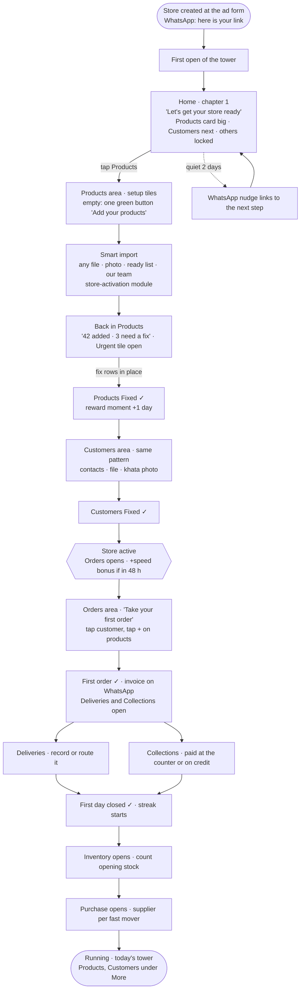

# Control Tower — the store journey: activation first, then the day

**Proposal · 15 Oct 2026 · v10 · nothing built.** Store activation brought into the Control Tower as its
first areas. A new store opens the tower on its setup; each area opens when the store has what that
area runs on; rewards pay for real progress. Decisions for the owner are in §10.

This file and its artifact (https://claude.ai/artifact/A4MZEiYi8fX6CNrAtw6uV3, with phone mockups of each
chapter, a setup area and an unlock) are twins: edit this file first, then the page.

Sources: the activation call of 9 Oct 2026 and the store-activation module
(`foodbridge-module-digital-assistant`: root addenda 018–022, `modules/store-activation/discovery/design-principles.md`,
SSOT v1–v9 on QA); this folder's `CONTROL_TOWER_LEVERS.md`, `_DESIGN.md`, `_UX_FLOW.md`, `_INCIDENTS.md`;
D-015 (evidence decides capability). Research in §9.

---

## 1. The idea in one line

> **The tower is the store's journey.** A new owner's tower opens on *Products* and *Customers*. Each
> area goes **Added → Fixed → Complete**, and when it is complete the area it feeds opens: Orders,
> then Deliveries and Collections, then Inventory and Purchase. The day's tower the owner ends up
> running is the same one; they built it themselves, an area at a time.

Why the tower and not a separate Getting-started page:

| A separate activation page (today's module) | Activation inside the tower (this proposal) |
| --- | --- |
| Done at 2 of 2, then the owner is dropped on a dashboard they have never seen | The finish line of setup is the start of the day's tower; no hand-over |
| Steps don't say what they are for | Every step names the area it opens ("Add delivery addresses — Deliveries opens") |
| A second home, a second score, a second nudge engine | One home, one shape (headline · tiles · rows), one Timeline, one Assistant |
| The other areas are "not connected" previews with example figures | An area is locked until the store holds its evidence — D-015, made into the journey |

## 2. Why this order: the areas depend on each other's records

The order isn't a tutorial order. It is what each area needs before it can compute anything (D-015:
evidence decides capability).

```
Products ─┬─► Orders ─┬─► Deliveries ─┐
Customers ┘           └─► Collections ┴─► Running the day
Products ───► Inventory ───► Purchase ─────► Staying stocked
Recipes (manufacturers) ───► Production
```

| Area | Opens when the store has | Because the area computes |
| --- | --- | --- |
| **Products** | — (first) | — |
| **Customers** | at least one product saved (as in store-activation SA-3) | — |
| **Orders** | Products and Customers *fixed* | orders need a valid product, rate, GST and a customer |
| **Deliveries** | the first order | a delivery is an order going out |
| **Collections** | the first order | money owed starts with an order |
| **Inventory** | Products fixed + an opening stock count | stock cover needs stock and sales |
| **Purchase** | Inventory live + one supplier | what to buy needs stock, demand and who sells it |
| **Production** | manufacturers only: a recipe | the plan needs recipes |

The owner can open any unlocked area in any order. Locks are honest and say why: "Opens after your
first order".

## 3. One area's three stages

Every setup area reads exactly like a live area: a headline, **On track / Needs work / Urgent** tiles,
and rows. Only what the tiles count changes: during setup they count **the data**, not the business.

| Stage | Means | Tiles during setup |
| --- | --- | --- |
| **Added** | something is in | — |
| **Fixed** | nothing in it would break an order or an invoice | **Urgent** = rows that would break one |
| **Complete** | it has what the *next* area needs | **Needs work** = rows missing a field a next area runs on |
| **Live** | the area runs on the business | the area's normal tiles (`CONTROL_TOWER_LEVERS.md`) |

**"Complete" is never a form to fill.** A field is asked only when an area that needs it is next, and
the row says which (D-015: "a field existing in the backend is not a reason to ask for it").

### Products

| Stage | Done when | Row says |
| --- | --- | --- |
| Added | ≥ 1 product saved (the card shows "42 added") | — |
| Fixed | no product missing a name, a unit, a rate that is a number, or a GST rate; no duplicate | "No rate · orders can't price it" |
| Complete | pack size (big unit) on every product sold by the case; MRP | "No MRP · Inventory can't value it" |

### Customers

| Stage | Done when | Row says |
| --- | --- | --- |
| Added | ≥ 1 customer saved | — |
| Fixed | every customer has a valid phone; no duplicate phone | "No phone · can't send the invoice" |
| Complete | delivery location pinned; credit days set (or "cash only") | "No location · Deliveries can't route it" · "No credit days · Collections can't colour it" |

### Orders → Deliveries → Collections → Inventory → Purchase

| Area | Added | Fixed | Complete → Live |
| --- | --- | --- | --- |
| Orders | first order | it was invoiced right and sent to the customer | orders on 3 different days (the reorder rhythm needs a history) |
| Deliveries | first delivery recorded | a van and driver named | one full day's route closed |
| Collections | first payment recorded (paid at the counter counts) | opening dues (udhaar) brought in | credit days on customers who owe → colours live |
| Inventory | opening stock counted | no product with unknown or negative stock | 7 days of stock moving with orders |
| Purchase | one supplier | a supplier on every fast mover | first purchase order received |

When an area goes Live, its setup tiles are replaced by the normal ones, in place. Products and
Customers never go Live as business areas: once complete they leave the home cards and stay under
**More** as quiet data-health rows ("2 products need a fix"), so a new product added badly next month
still surfaces.

## 4. The whole store: four chapters

The home tells the owner which chapter they are in. A chapter is just the areas in focus.

| Chapter | Areas in focus | The home's line | Footer |
| --- | --- | --- | --- |
| **1 · Set up your store** | Products, Customers | "Let's get your store ready · 1 of 2 done" | Tower · Products · Customers · More |
| **2 · Take your first orders** | Orders | "Your store is ready · take your first order" | Tower · Orders · Customers · More |
| **3 · Run your day** | Deliveries, Collections | "First order in · deliver it and get paid" | Tower · Deliveries · Collections · More |
| **4 · Stay stocked** | Inventory, Purchase | "Your day is running · now keep stock right" | Tower · Deliveries · Collections · More |
| **Running** | all live | today's tower, unchanged | Tower · Deliveries · Collections · More |

The footer's two pinned slots follow the chapter (`PINS` in `screens/control-tower.js` becomes a
function of the chapter). From chapter 3 on they are today's Deliveries · Collections — "goods out,
money in", the reason they were pinned.

**"Store active"** is the end of chapter 1: Products and Customers both Fixed. It is the same event
the store-activation module already records (`activatedAt`), so the team's 200 → 50 → 20 funnel
(activation call, AJ-14) reads one definition.

## 5. The flow



What the owner sees at each moment:

1. **First open (chapter 1).** Greeting, then one big **Products** card with its next step as the line
   ("Add your products · 2 min"). Customers sits under it, "Opens after your first product". Every
   other area is a single dimmed row, "Orders · opens when your store is ready", with a lock and one
   line of what it will do. No example figures: the tower starts empty and honest.
2. **Inside a setup area.** The headline is the stage ("42 products · 3 need a fix"); the three tiles
   count the data; rows are the products to fix, worst first; tapping one opens its card with the one
   field missing and one green button. The add action is the area's own button while it is empty,
   and later the area's footer action (the same work-screen pattern Deliveries uses, `TRIP` in
   `assets/platform.js`).
3. **An unlock is a moment, not a toast.** A sheet: big check, "Orders is open", what it will do in one
   line, the reward earned, one button "Take your first order". It also goes to the Timeline as news.
4. **Chapter changes re-pin the footer** and the home's line changes. Nothing else moves.
5. **Running.** The home is today's tower. The journey card is gone; Rewards stays under More.

## 6. Rewards: what earns, what it is worth

### 6.1 What research says, and what we take from it

| Finding | Strength | We take |
| --- | --- | --- |
| Checklists with visible progress and few steps lift activation | well-supported pattern; lift figures are vendor case studies | the stages *are* the checklist; 2–3 items per area |
| A head start ("endowed progress") motivates finishing | vendor guidance | "Store created ✓" is already ticked on first open |
| Progress indicators help onboarding; points and levels get mixed responses, depending on autonomy and relevance to work goals (B2B SaaS onboarding thesis, 3 products, 7 interviews) | small study | progress is the main motivator; rewards are tied to real business milestones, never to clicks |
| External rewards can crowd out interest once removed (overjustification) | academic, not re-checked here | rewards taper after the first month; the habit is carried by the owner's own numbers (Timeline, morning plan) |
| FMCG field-sales tools weight harder actions more (a new outlet over a routine reorder) | vendor playbook | weights follow business value: an order delivered > a product added |
| A perceived longer onboarding means higher churn | vendor guidance | no reward ever adds a step |

### 6.2 The currency: free days of FoodBridge

| Option | For | Against |
| --- | --- | --- |
| Points / coins | flexible, gamey | abstract; hollow unless they buy something; one more thing to explain |
| **Free days of FoodBridge** (recommended) | tangible to a distributor; costs FoodBridge only for the owners who engage, which are exactly the 20 we want; extends the trial for the fast movers | needs a subscription clock on the account |
| WhatsApp message credits | useful the day reminders are used; feeds Collections | means nothing in chapter 1 |
| Cashback / UPI money | strongest pull | costly, gamed easily, not tied to using the product |

**Recommendation:** free days through chapter 3; WhatsApp credits for the daily habit (chapter 3 on),
because every reminder sent is money collected, and the reward feeds the area it is earned in.

### 6.3 What earns (values are placeholders for the owner)

| Milestone | Proof (from the platform's records, not a tap) | Reward |
| --- | --- | --- |
| Products Fixed | ≥ 10 valid products, no Urgent row | +1 day |
| Customers Fixed | ≥ 5 customers with a valid, distinct phone | +1 day |
| **Fast start**: store active within 48 h of the store being created | `activatedAt − createdAt ≤ 48 h` | +3 days |
| Products / Customers Complete | no Needs-work row | +1 day each |
| First order | invoiced to a real customer, sent on WhatsApp | +2 days |
| First delivery | delivered, with proof | +2 days |
| First payment | recorded (counter or credit) | +2 days |
| First week | orders on 5 of the first 7 days | +5 days |
| Day closed | the day's deliveries settled and cash recorded | +10 WhatsApp credits |
| 7 days closed in a row | 7 day-closes | +1 day |

Caps: setup and firsts are once per store; free days capped (e.g. 30 in the first 60 days); credits
capped per day.

### 6.4 Rules the engine keeps

1. **Earned by proof, never by say-so** (the incident engine's rule). A reward reads the same records
   the areas read; there is no "claim" button.
2. **Derived, not stored.** The earned list is computed from milestones on every pass (as the
   store-activation score is "derived on read"); only redemptions are written.
3. **Undone work is unearned.** Deleting the products that earned "Products Fixed" withdraws the
   unredeemed reward; a duplicate customer never counts.
4. **Demo and sample data earn nothing.** The live demo business and "Try sample data" show the
   rewards, marked Example.
5. **Kind, never punishing.** No leaderboard across stores, no lost points, no "you broke your streak":
   a missed day just starts a new count.
6. **Never adds a step.** A reward is announced on the unlock sheet the owner was going to see anyway.

### 6.5 Where rewards show

- The unlock sheet: "+2 free days".
- The top bar on desktop and the More sheet on phone: **Rewards · 9 free days**, opening a list of
  what was earned, newest first, and what is next to earn (one row).
- The Timeline: "You earned 3 free days for a fast start".
- The Assistant: "What's next?" answers the next step and what it earns.

## 7. The team's side

The same journey is the team's call list (activation call AJ-13, AJ-14):

| The team reads | From |
| --- | --- |
| chapter and stage per area, time since store created | the journey model |
| fast start or not; days quiet | journey + last activity |
| rewards earned (proxy for effort = intent, AJ-15) | the rewards ledger |

Ranked: chapter 2+ first, then fast starts, then quiet stores in chapter 1 with something added.
In production it rides the customer-success lead card (`store.created` webhook) as a later event,
e.g. `store.stage_changed`, so the board tool stays an adapter.

## 8. How it fits the code (v10 mock first)

**Built 15 Oct 2026, the engine first.** The journey runs on a context-free graph engine:
`assets/journey/engine.js` (contract `fb.journey/1`, `assets/journey/README.md`), the store journey as
data (`assets/journey/graphs/store-journey.json`), the store's records as facts
(`assets/ct/journey-facts.js`), and a lab to inject both (`screens/journey-lab.html`). The engine knows
no business. A new area, a new flow, a rotation, or a graph Claude writes from a store's database is
new JSON. **Wired into the tower the same day.** Home's chapter line, the focus card, the locked
rows, the footer's two areas and the unlock sheet are all drawn from the graph's type and payload
(`assets/ct/journey-view.js`). Each area's step sheet links to its platform screen, and in the
new-store demo a button does the step. The journey is opt-in: More → Start as a new store, or
`?journey=new`. The live demo business is unchanged until the owner decides D1. Not built yet: the
setup tiles inside Products and Customers, rewards beyond the free-days count (fast start,
redemption), and Timeline news for unlocks.

**Same day, the owner's next ask: "make it look like gamification, so the user feels facilitated", and
use store activation's own product and customer add as is.** The step sheet is now a quest: the
assistant says what to do in one line; the area's steps form a path, each with the free days it earns;
the step to do now is open on the path; the store's progress and the free days earned sit under it;
one green button. The focus card carries its reward chip, and an unlock is the assistant, proud, with
confetti. Products and Customers open **store activation v0.1.12, as released**
(`modules/foodbridge-store-activation`): the module's own modal over the tower, on its in-memory API,
with what it saves read back as the journey's facts. As released it is desktop only; on a phone it
shows its own "Activate your store on a computer" screen, and the step's demo link remains.

Pure models, the tower's pattern: no DOM, no storage, no clock; tested under node.

| Piece | What |
| --- | --- |
| `assets/ct/journey.js` (new) | the dependency graph (§2), each area's stage from records (§3), the chapter (§4), the next step |
| `assets/ct/rewards.js` (new) | the rules table (§6.3) → earned list, from journey milestones; redemptions read from `fb.v7.ct.rewards` |
| `assets/ct/levers.js` | an area carries `stage`: `locked` · `setup` · `live`; two new builders, `products(c)` and `customers(c)`, in the same tile shape; `preview` stays only for the live demo |
| `screens/control-tower.js` | home: chapter line, the focus card, locked rows; `PINS` from the chapter; the unlock sheet; Rewards in More and the top bar |
| `assets/ct/timeline.js`, `assets/ct/chat.js` | unlock and reward news; a "what's next" intent |
| `assets/ct/demo.js` | a **new-store demo**: day 0, empty, which moves only when the user does the steps (beside today's live demo) |
| `assets/platform.js` `TRIP` | work-screen footers for products, customers and orders, as Deliveries has |

In production the add/fix work is the store-activation module (Smart import, the review sheet, the
signals port, `activatedAt`); the tower reads its signals and opens its modal. Nothing is built twice.

## 9. Research sources

- Shopify App Home, setup guide pattern — https://shopify.dev/docs/api/app-home/patterns/compositions/setup-guide
- Userpilot, improving activation rate (checklists, 2–5 key actions, segmenting) — https://userpilot.com/blog/improve-activation-rate/
- StriveCloud, 25 user growth experiments (endowed progress; longer onboarding, higher churn) — https://strivecloud.io/blog/25-user-growth-experiments
- Evaluating the impact of gamification on user engagement in B2B SaaS onboarding (thesis) — https://www.utupub.fi/handle/11111/20236
- BeatRoute, FMCG sales gamification (weight harder actions) — https://beatroute.io/resources/blog/how-fmcg-companies-increase-sales-through-gamification/
- Activation benchmarks (25–30 % reaching the milestone is "on track"; directional) — https://www.shno.co/startup-metrics/activation-rate

Most lift figures in these sources are vendor case studies: hypotheses to test, not results to promise.

## 10. Decisions for the owner

| # | Decision | Recommended |
| --- | --- | --- |
| D1 | **Two ways into the tower.** A real new store gets the journey (locked areas, empty and honest). "Explore the demo" keeps today's live demo, where no area is "not connected" (22 Sep decision) | yes: the 22 Sep rule was for the demo; D-015 governs a real store |
| D2 | The reward currency | free days through chapter 3; WhatsApp credits for the daily habit |
| D3 | The stage words on screen | **Added · Fixed · Complete** (internally "groomed"); "Ready" if "Complete" reads as homework |
| D4 | Products and Customers after setup | leave the home; quiet data-health rows under More |
| D5 | Reward values and caps (§6.3) | the table as drafted, capped at 30 free days in 60 days |
| D6 | Can an owner skip an area ("not for my business")? | yes for Production and Purchase; never for Products, Customers, Orders |

## 11. Phasing — must-haves first

| Phase | Scope | Measured by |
| --- | --- | --- |
| **1 · Find the 20** | chapter 1–2: Products, Customers (Added/Fixed/Complete), Orders unlock and first order; locks; footer by chapter; unlock sheet; free days for setup, fast start, first order; Timeline news | store active within 4 days (target: 50 of 200); first order within 7 days |
| 2 · Run the day | Deliveries and Collections stages; first delivery and payment rewards; day closed + WhatsApp credits; the team's ranked list | day-7 and day-30: share of active stores closing days |
| 3 · Stay stocked | Inventory, Purchase, Production stages; Rewards page and redemption; `store.stage_changed` to the lead board | stores reaching Running; reward cost per converted store |

Out of scope for now: leaderboards, referral rewards, cash rewards, levels or badges beyond the
chapters.

**Later the same day the owner rejected the sheets.** In the owner's words: "this new bottom sheet flow is trash. I want to stick to
that exact original control tower UI-UX flow". The journey is now drawn only with the tower's own
pieces. Home is the greeting, the chapter's line and the area cards. A card opens the area page (the
back bar, the headline, On track / Needs work / Urgent, the list) with one button in the page. A step
done is a one-line toast. The quest sheet, the step sheet, the unlock sheet, the chapter trail and the
locked list are gone. Store activation's modal still opens from the Products and Customers page
buttons.

**Later the same day: back to the tower's incident flow.** In the owner's words: "it has to have incidents list below each On
track, Needs work and Urgent, and on click open the modal, where the user solves things or navigates to
the platform page with inline confirmation". Products now reads Finished Goods (product-management's frozen
discovery v7) with that page's own rules (`assets/ct/products-area.js`). Its banner's hidden-from-customers
rule (no unit, no price, no category) and its Needs Attention chips (short for open orders, out of stock,
below cost, above MRP, brand spelled two ways, no HSN) become one pill per product, under Urgent or Needs
work. A row opens the delivery-style modal. The lead fix (unit, price, category, brand spelling, HSN, a
stock count) slides in, is confirmed in place and ends on a done card. "Open in Finished Goods" asks inline
first. A fix is kept as the tower's own (`fb.v7.ct.productFixes`); the frozen page still shows its seed. The
docked page button is gone (§4.8). Step rows open the tower's item sheet, and a platform screen asks inline
before leaving.
